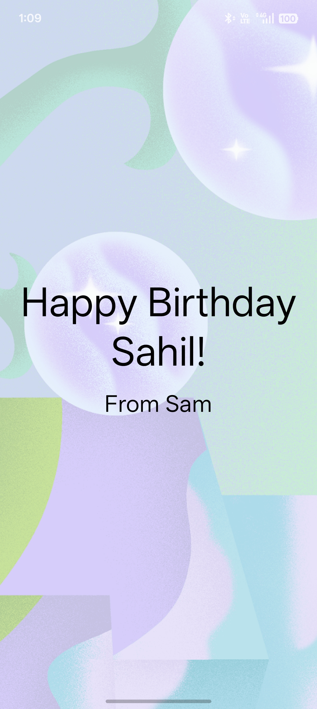
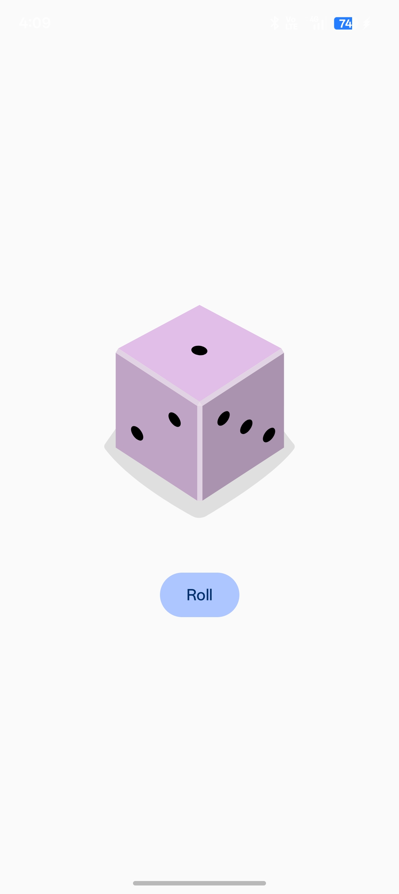
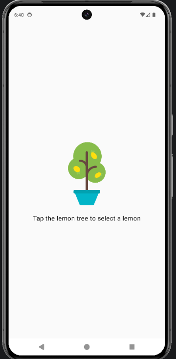
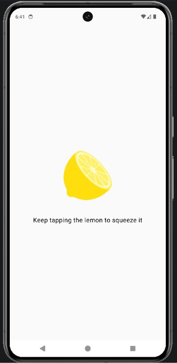
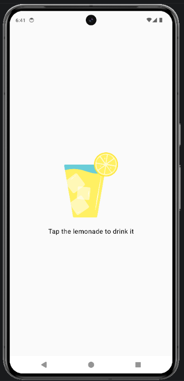
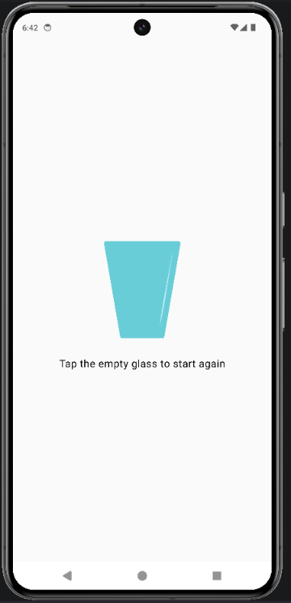

# Android Basics with Compose

A hands-on Android development journey with **Kotlin** and **Jetpack Compose**, following Google's **Android Basics with Compose** course.

The goal is simple:

> **Learn → Build → Get Stuck → Understand → Fix → Document → Push**

This repository documents the projects, concepts, and progress I build along the way.

---

## 🛠️ Tech Stack

- **Kotlin**
- **Jetpack Compose**
- **Material 3**
- **Android Studio**

---

## 📚 Learning Path

This repository follows Google's official **Android Basics with Compose** course as the main learning spine.

### Unit 1 — Your First Android App

- [x] Introduction to Kotlin
- [x] Set up Android Studio
- [x] Build a basic layout
- [x] Birthday Card
- [x] Business Card

### Unit 2 — Building App UI

- [x] Kotlin fundamentals 
- [x] Add a button to an app - Dice Roller,Lemonade
- [ ] Interacting with UI and state 

### Unit 3 — Display Lists and Use Material Design

- [ ] More Kotlin fundamentals
- [ ] Build a scrollable list
- [ ] Build beautiful apps

### Unit 4 — Navigation and App Architecture

- [ ] Architecture Components
- [ ] Navigation in Jetpack Compose
- [ ] Adapt for different screen sizes

### Unit 5 — Connect to the Internet

- [ ] Get data from the internet
- [ ] Load and display images

### Unit 6 — Data Persistence

- [ ] Introduction to SQL
- [ ] Use Room for data persistence
- [ ] DataStore

### Unit 7 — WorkManager

- [ ] Background work and WorkManager

### Unit 8 — Views and Compose

- [ ] Views and Compose interoperability

---

# 🚀 Projects

## 🎂 Birthday Card

My first Jetpack Compose UI project.

This project introduced me to building a simple Android interface using Compose and helped me understand the relationship between composable functions, layout containers, modifiers, images, and text.

### Concepts Practiced

- `@Composable`
- `Text`
- `Image`
- `Box`
- `Column`
- `Modifier`
- `padding`
- `Alignment`
- `Arrangement`
- Compose Preview
- Image and text layout
- Basic UI composition

---

## 💼 Business Card

A simple Business Card built by breaking the UI into smaller, reusable composables.

Instead of putting the entire interface into one function, the screen was divided into separate UI sections such as the profile and contact information.

### UI Structure

```text
BusinessCard
│
├── Profile
│   ├── Image
│   ├── Name
│   └── Title
│
└── ContactInfo
    ├── Phone
    ├── Social Handle
    └── Email
```

### Concepts Practiced

- Reusable composables
- `Column`
- `Row`
- `Image`
- `Text`
- Material Icons
- `Arrangement.spacedBy()`
- `horizontalAlignment`
- `Modifier.size()`
- Passing data through composable parameters
- Compose Preview
- Basic UI hierarchy

---
---
# 🧩 Unit 2 — Kotlin Fundamentals

**Status:** Kotlin Fundamentals completed ✅

Completed the Kotlin Fundamentals lessons in Google's **Android Basics with Compose** course, along with practical coding challenges to reinforce the concepts.

## Concepts Practiced

### 1. Conditionals and Control Flow

- `if`, `if-else`, and `if-else if-else`
- `when` expressions
- Age-based movie ticket pricing

### 2. Null Safety

- Nullable types using `?`
- Handling `null` values
- Safe-call operator `?.`
- Elvis operator `?:`
- Nullable object references

### 3. Classes and Objects

- Classes and constructors
- Properties and methods
- Object creation and interaction
- Inheritance and method overriding
- Visibility modifiers and access control
- Delegated properties
- Custom property validation using `RangeRegulator`

**Practice project:** Smart Home device system with a smart TV, smart light, and central controller.

### 4. Function Types and Lambda Expressions

- Lambda expressions
- Function types, such as `(Int) -> String`
- Higher-order functions
- Passing functions as arguments
- Returning functions from functions
- Temperature conversion using lambda expressions

## Practical Challenges Completed

- Movie ticket price calculator
- Temperature conversion program
- Song data model
- Person profile with nullable references
- Smart Home device controller

## Key Takeaways

- Write Kotlin programs using conditional logic.
- Work with nullable values safely.
- Model real-world objects using classes and inheritance.
- Pass functions as arguments and return functions.
- Apply Kotlin fundamentals through practical coding exercises.

 
# 🧩 Unit 2 —  🎲 Dice Roller

An interactive Android app built with Kotlin and Jetpack Compose as part of Google's Android Basics with Compose course.

The app displays a dice image and lets users roll the dice by tapping a button.

## Concepts Practiced

- `@Composable` functions
- `Button` and click handling with `onClick`
- `Image` and drawable resources
- State management using `remember` and `mutableStateOf`
- Random number generation with `(1..6).random()`
- Updating the UI through recomposition
- Layouts and `Modifier`
- Connecting a Compose screen to the existing Android activity

## What I Learned

How user interactions update state and how Jetpack Compose reacts to those changes by recomposing the UI.


*Note: This tree represents the intended organization of the Kotlin practice files. Update the filenames or folders to match your actual Android Studio project.*


---

## 🍋 Unit 2 — Lemonade App

An interactive Android app built with Kotlin and Jetpack Compose as part of Google's Android Basics with Compose course.

The app guides users through four stages: selecting a lemon, squeezing it, drinking the lemonade, and starting again.

### Concepts Practiced

- `@Composable` functions
- `Image` and drawable resources
- State management using `remember` and `mutableIntStateOf`
- Conditional UI using `when`
- Click handling with `Modifier.clickable`
- Random number generation using `(2..4).random()`
- Updating images and text based on state
- UI recomposition in Jetpack Compose

### What I Learned

How to manage UI state, handle repeated user interactions, and update the interface according to the current step in a simple interactive application.


## 📱 Unit 1 Screenshots

 <div align="center">

<table>
<tr>
<td align="center">

<b>🎂 Birthday Card</b><br><br>


</td>

<td>&nbsp;&nbsp;&nbsp;&nbsp;</td>

<td align="center">

<b>💼 Business Card</b><br><br>


</td>
</tr>
</table>

</div>

---
---


---

## 📱 Unit 2 — App Screenshots

### 🎲 Dice Roller


<div align="center">

### 🎲 Dice Roller



**Dice Roller**

*Roll the dice by tapping the button.*

</div>


### 🍋 Lemonade App

<table>
  <tr>
    <td align="center">
      
      <br/>
      <b>1. Select a lemon</b>
    </td>
    <td align="center">
      
      <br/>
      <b>2. Squeeze the lemon</b>
    </td>
    <td align="center">
      
      <br/>
      <b>3. Drink the lemonade</b>
    </td>
    <td align="center">
      
      <br/>
      <b>4. Start again</b>
    </td>
  </tr>
</table>


---

### 📂 Project File Structure

```text
app/src/main/
├── java/com/mdsahil/birthday/
│   ├── MainActivity.kt
│   └── unit2/
│       ├── kotlinfundamentals/
│       │   ├── conditionals/
│       │   ├── nullsafety/
│       │   ├── classesobjects/
│       │   └── functiontypesandlambda/
│       │
│       ├── diceroller/
│       │   └── DiceRollerScreen.kt
│       │
│       └── lemonade/
│           └── LemonadeApp.kt
│
└── res/
    └── drawable/
        ├── dice_1.xml
        ├── dice_2.xml
        ├── dice_3.xml
        ├── dice_4.xml
        ├── dice_5.xml
        ├── dice_6.xml
        ├── lemon_tree.*
        ├── lemon_squeeze.*
        ├── lemon_drink.*
        └── lemon_restart.*

docs/
└── screenshots/
    ├── birthday-card.jpg
    ├── business-card.jpg
    ├── dice-roller.jpg
    ├── lemonade-tree.png
    ├── lemonade-squeeze.png
    ├── lemonade-drink.png
    └── lemonade-restart.png
```

*The `*` extensions represent the actual image file extensions in your project.*


# 📸 Project Documentation

Screenshots and supporting documentation are stored inside the `docs` directory.

```text
docs/
└── screenshots/
    ├── birthday-card.jpg
    └── business-card.jpg
    └── dice-roller.jpg
    ├── lemonade-tree.png
    ├── lemonade-squeeze.png
    ├── lemonade-drink.png
    └── lemonade-restart.png
```

The screenshots document the visible result of each learning milestone and will continue to be updated as new projects are completed.

---

# 🧠 Learning Approach

This repository is not intended to be a collection of copied tutorial code.

The goal is to learn by actually building.

```text
Learn
  ↓
Build
  ↓
Get Stuck
  ↓
Understand
  ↓
Fix
  ↓
Document
  ↓
Push
  ↓
Move Forward
```

When something doesn't make sense, I try to understand the underlying concept instead of simply copying a solution.

The repository is therefore also a record of my progression from basic Compose UI toward building complete Android applications.

---

# 📈 Progress

Every completed project adds another practical piece to the Android development journey.

The focus is not on creating a large number of commits just to keep the contribution graph active.

The focus is on making **real progress through real code**.

Each meaningful milestone is documented with:

- The concept learned
- The code built
- The resulting UI
- The relevant screenshot
- A Git commit

---

# 🎯 What's Next?

## Unit 2 — Building App UI

Kotlin Fundamentals completed. Moving forward with the remaining Unit 2 lessons.

## Next Steps

- [x] Complete Kotlin Fundamentals
- [x] Add a button to an app - Dice Roller,Lemonade
- [ ] Interact with UI elements and state  
- [ ] Understand state and recomposition in Jetpack Compose
- [ ] Build interactive Android interfaces

## Next Milestone

Apply Kotlin fundamentals to interactive Android UI development with Jetpack Compose.


More projects and screenshots will be added as the journey continues.
---

# 📖 Course

This repository follows Google's official course:

**[Android Basics with Compose](https://developer.android.com/courses/android-basics-compose/course)**

---

## 🌱 Building in Public

This repository is a record of the journey — from learning the fundamentals of Kotlin and Jetpack Compose to eventually building larger, production-oriented Android applications.

**One concept. One project. One commit at a time.**
